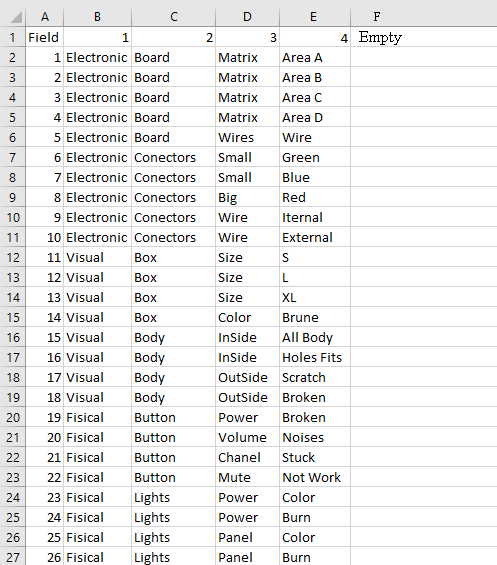
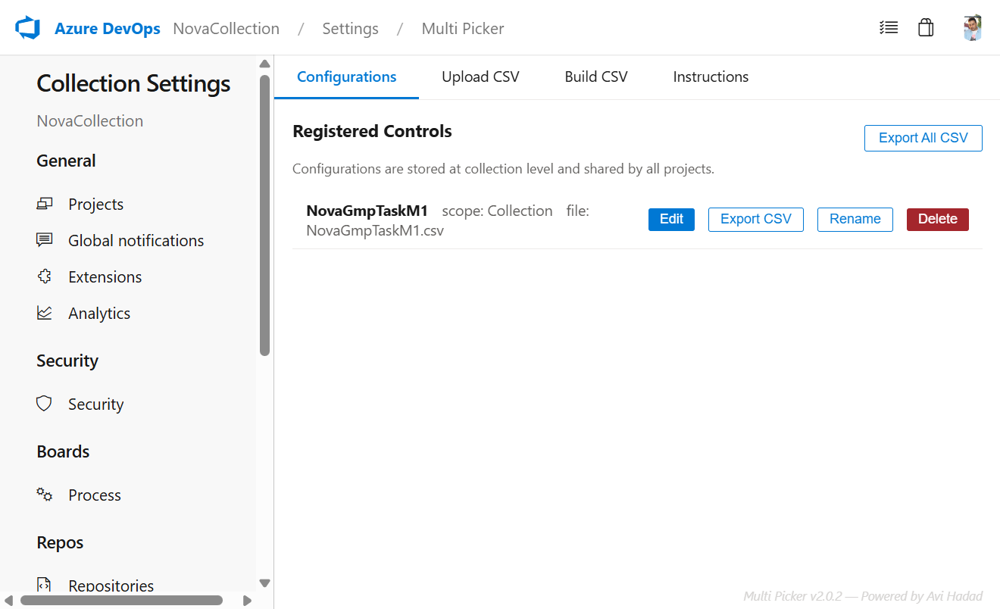
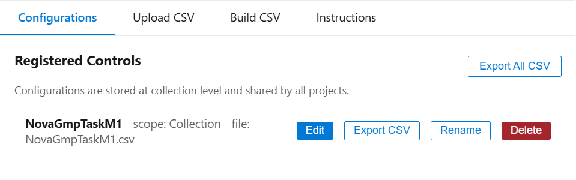
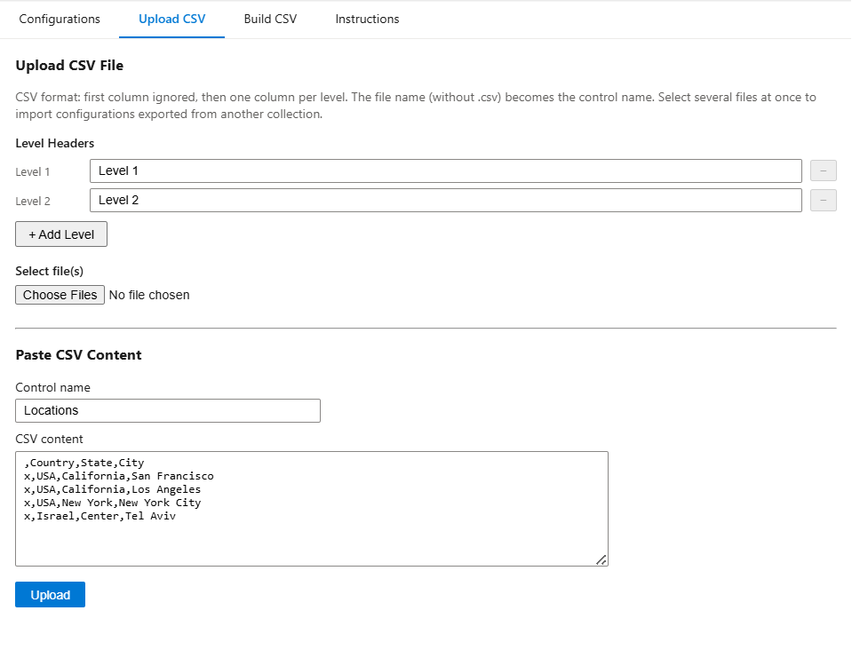
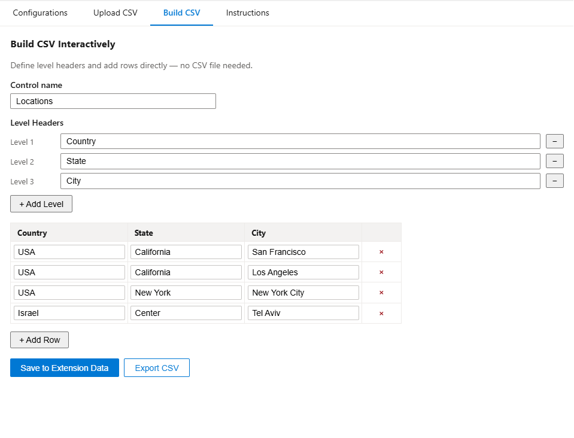
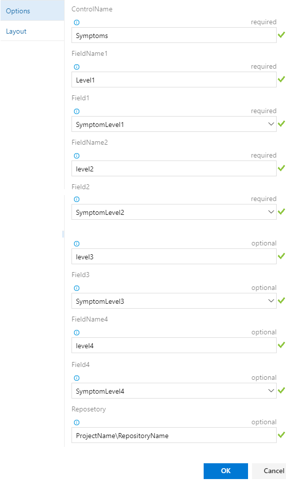
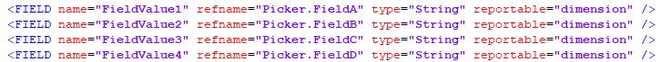
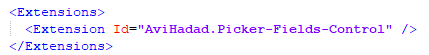
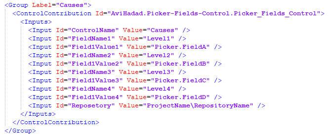
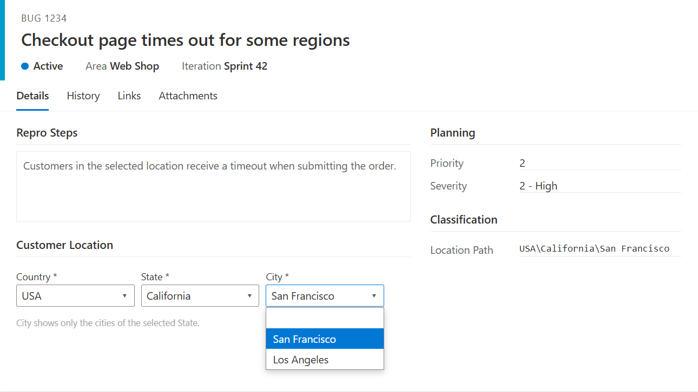

# Multi Pickers Fields Control

Cascading (dependent) drop-down lists for Azure DevOps work item forms. Pick a value in level 1 and level 2 shows only the values that belong to it, and so on for up to **8 levels**. For example: Country → State → City, or Product → Component → Sub-component.

Lists are managed from a simple **CSV file** or an **interactive grid**, not from huge XML global lists. They are stored once per collection and **shared by every project**.

## Features

| Feature | Description |
|---|---|
| **Cascading pickers, 2–8 levels** | Each level is filtered by the values selected above it. |
| **Any work item field** | Each level writes to a String, Integer or Double field you choose. |
| **Hide / Required per level** | Hide a level from the form, or mark it as required (an asterisk and a red border appear while it is empty). |
| **Path summary field** | Optionally writes all selected values as a `Level1\Level2\Level3` path into another field. Useful for queries. |
| **Auto-select** | With *Private Behaviour = Auto*, a level that has only one option is filled in automatically. |
| **Layout** | Show 1–4 drop-downs per row. |
| **Project Settings hub** | Manage everything from **Project Settings → Multi Picker**. |
| **Collection-wide storage** | Each configuration is stored once at collection level, so every project sees and can use every configuration. |
| **Per-project override** | A list named `ProjectName_ControlName` overrides the shared `ControlName` list in that project. |
| **CSV upload** | Upload one or many CSV files, or paste the CSV text. |
| **Interactive CSV builder** | Create or edit lists in a grid with named level headers. No file needed. |
| **Edit / Rename / Delete** | Manage existing configurations from the Configurations tab. |
| **Export CSV** | Export one configuration, or all of them, as CSV files. Re-import them into another collection or server. |
| **Backup** | Use **Export All CSV** to keep a copy of every list, for example committed to a Git repository. |
| **Work item context menu** | Upload a CSV directly from a work item's **…** menu (*Upload Picker csv*). |
| **Light & dark theme** | Follows the Azure DevOps theme. |

---

## User Guide

### 1. Prepare the data (CSV)

* Row 1 is the header. The first column is ignored, then add one column per level. The header names become the level labels in the builder.
* Every following row is one full path. The first column must be **non-empty** (for example `x`).
* Values are case- and space-sensitive. Avoid trailing spaces, because `"Tel Aviv "` and `"Tel Aviv"` are two different values.
* Values must not contain commas.
* Duplicate rows are skipped automatically.

```
,Country,State,City
x,USA,California,San Francisco
x,USA,California,Los Angeles
x,USA,New York,New York City
x,Israel,Center,Tel Aviv
```



**Naming:** the file name, without `.csv`, is the **Control Name**.

* `Locations.csv` creates the shared list `Locations`. All projects use it.
* `MyProject_Locations.csv` creates a list used only by `MyProject`, in place of `Locations`.

### 2. Manage configurations (Project Settings → Multi Picker)

Open **Project Settings** in **any** project and select **Multi Picker**. All projects show the same set of configurations, because they are stored at collection level.



The hub has four tabs:

**Configurations**: lists every registered control, with its scope (`Collection` = shared, or a project name) and file name.

* **Edit**: opens the control in the builder.
* **Export CSV**: downloads `ControlName.csv`.
* **Rename**: renames the control. Remember to update the *Control Name* input on your forms.
* **Delete**: removes the control and its data.
* **Export All CSV**: downloads one CSV per configuration.



**Upload CSV**: select one or more `.csv` files, or paste CSV text and enter a control name. An existing control with the same name is overwritten.



**Build CSV**: set the control name, add or rename levels, fill the grid, then select **Save to Extension Data** or **Export CSV**.



**Instructions**: a quick in-product reference.

### 3. Add the control to a work item form

**Inherited process (Azure DevOps Services / Server 2019+):**

1. Go to **Organization/Collection Settings → Process → (your process) → (work item type)**.
2. Select **Add custom control** and choose **Multi Pickers Fields with dependencies**.
3. Fill in the inputs (see the table below) and save.



**Hosted XML / On-premises XML process:** add the fields, register the extension, and place the control in the layout:





#### Control inputs

| Input | Required | Description |
|---|---|---|
| **Control Name** | Yes | Name of the configuration to use (the CSV file name, without `.csv`). |
| **Field Count** | No | Not used in 2.x. Levels are read in order from 1 and stop at the first level whose *Field Name N* and *Field N* are both empty (maximum 8). |
| **Field Name N** | Levels 1–2 | Label shown above the drop-down for level N. |
| **Field N** | Levels 1–2 | Work item field that stores the value selected at level N. |
| **Hide Field N** | No | Hides level N on the form. The value is still filtered and saved. |
| **Field N Required** | No | Marks level N with `*` and highlights it in red while it is empty. To block saving, also make the field required in the process. |
| **Summarize to Path field** | No | Field that receives the full `A\B\C` path. |
| **Backup Repository** | No | Not used in 2.x. To back up your lists, use **Export All CSV** (see section 6). |
| **View Option** | No | Drop-downs per row, 1–4. Default is 1. |
| **Private Behaviour** | No | `Auto`: automatically selects a level when it has only one option. |

### 4. Use it

Open a work item. Each drop-down shows only the values that are valid for the selections above it. Changing a higher level clears the levels below it.



### 5. Move configurations to another collection / server

1. In the source collection, open **Project Settings → Multi Picker → Configurations**.
2. Select **Export All CSV**, or **Export CSV** on a single control. Each file is saved as `ControlName.csv`. If your browser asks, allow multiple downloads.
3. Install the extension in the target collection.
4. Open **Project Settings → Multi Picker → Upload CSV** in any project there, and select all of the exported files at once.
5. The control names are taken from the file names, so existing forms that use the same *Control Name* work without any changes.

### 6. Back up your lists

Select **Export All CSV** on the Configurations tab, then store the files somewhere safe, for example committed to a Git repository. To restore them, upload the files again on the **Upload CSV** tab.

---

## Release notes

* **2.x**: Hub moved to **Project Settings**. Data is still stored at collection level and shared by all projects. Added **Export CSV** / **Export All CSV**, multi-file import, the interactive builder, rename, up to 8 levels, and Hide / Required per level.
* **1.1.315**: Added *Private Behaviour* (`Auto`).
* **1.1.308**: Added the *Summarize to Path* field.

## Permissions

The extension stores lists in Azure DevOps Extension Data, at collection scope.

Contact: avih75@gmail.com
